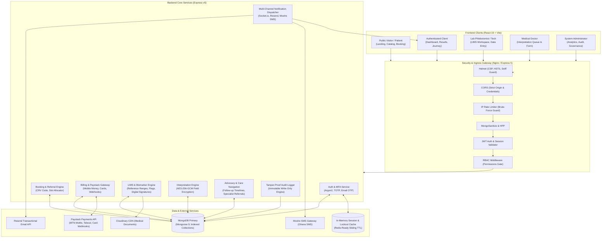
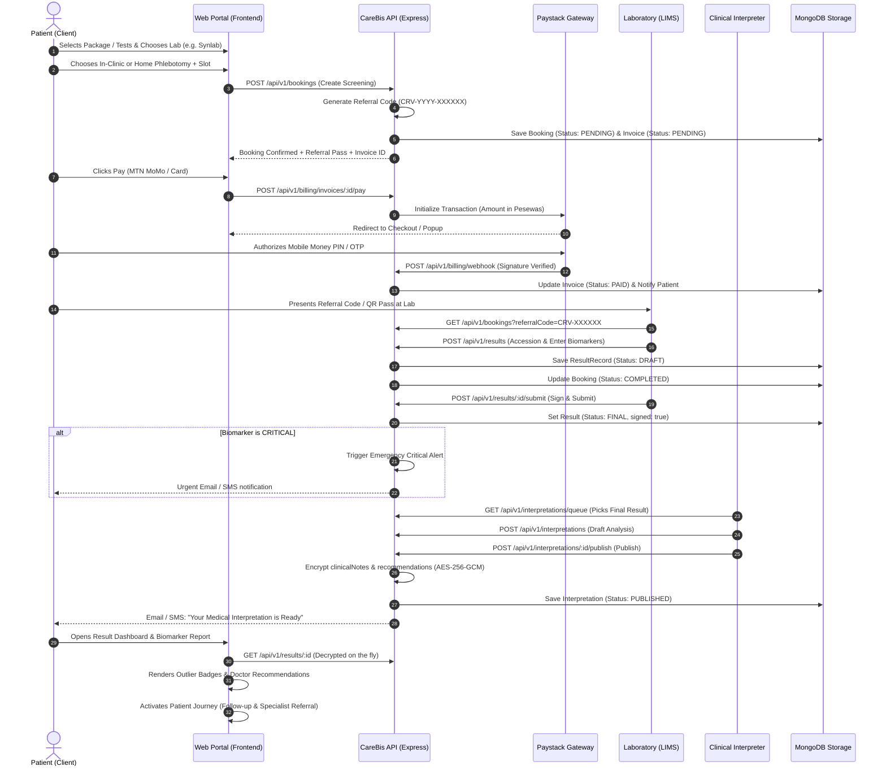

# CareBis Prime Health (CareVo) — Preventive Healthcare Platform

> **Clinical-grade, preventive diagnostic screening, laboratory information management (LIMS), and medical interpretation platform tailored for non-communicable disease (NCD) interception and wellness monitoring in Ghana and emerging African healthcare markets.**

---

## Table of Contents

1. [Executive Overview & Vision](#1-executive-overview--vision)
2. [High-Level Architecture & Tech Stack](#2-high-level-architecture--tech-stack)
   - [Monorepo Directory Structure](#monorepo-directory-structure)
   - [System Architecture Diagram](#system-architecture-diagram)
   - [Technology Matrix](#technology-matrix)
3. [Health Pillars, Biomarkers & Clinical Taxonomy](#3-health-pillars-biomarkers--clinical-taxonomy)
   - [The Core Health Pillars](#the-core-health-pillars)
   - [Diagnostic Panels & Screening Packages](#diagnostic-panels--screening-packages)
   - [Biomarker Reference Registry & Critical Thresholds](#biomarker-reference-registry--critical-thresholds)
   - [4-Tier Risk Categorization System](#4-tier-risk-categorization-system)
4. [Role-Based Access Control (RBAC) & Actor Archetypes](#4-role-based-access-control-rbac--actor-archetypes)
   - [Actor Personas](#actor-personas)
   - [Granular Permissions Matrix](#granular-permissions-matrix)
5. [End-to-End System Lifecycles & Phases](#5-end-to-end-system-lifecycles--phases)
   - [Phase 1: Discovery & Public Education](#phase-1-discovery--public-education)
   - [Phase 2: Booking Wizard & Digital Referral Generation](#phase-2-booking-wizard--digital-referral-generation)
   - [Phase 3: Billing, Invoicing & Paystack Gateway Integration](#phase-3-billing-invoicing--paystack-gateway-integration)
   - [Phase 4: Laboratory Accessioning & Diagnostic Entry (LIMS)](#phase-4-laboratory-accessioning--diagnostic-entry-lims)
   - [Phase 5: Critical Outlier Alert & Triaging Workflow](#phase-5-critical-outlier-alert--triaging-workflow)
   - [Phase 6: Clinical Interpretation & Translation Pipeline](#phase-6-clinical-interpretation--translation-pipeline)
   - [Phase 7: Client Diagnostic Report & Biomarker Presentation](#phase-7-client-diagnostic-report--biomarker-presentation)
   - [Phase 8: Patient Journey & Preventive Health Advocacy](#phase-8-patient-journey--preventive-health-advocacy)
6. [UI/UX Architecture & Design System](#6-uiux-architecture--design-system)
   - [Design Tokens & Brand Theme](#design-tokens--brand-theme)
   - [Typography Hierarchy](#typography-hierarchy)
   - [Layout Archetypes](#layout-archetypes)
   - [Exhaustive Page-by-Page & Screen Inventory](#exhaustive-page-by-page--screen-inventory)
7. [Security, Privacy & Compliance Engineering](#7-security-privacy--compliance-engineering)
   - [Authentication & Session Lifecycle](#authentication--session-lifecycle)
   - [Dual Multi-Factor Authentication (MFA)](#dual-multi-factor-authentication-mfa)
   - [Field-Level Encryption (AES-256-GCM)](#field-level-encryption-aes-256-gcm)
   - [Tamper-Proof Immutable Audit Trail](#tamper-proof-immutable-audit-trail)
   - [Web Application Security Suite](#web-application-security-suite)
8. [Database Schema & Entity Relationship Model](#8-database-schema--entity-relationship-model)
9. [Comprehensive API Route Directory](#9-comprehensive-api-route-directory)
10. [Local Development, Environment & Seed Data](#10-local-development-environment--seed-data)
    - [Prerequisites](#prerequisites)
    - [Environment Configuration (`.env`)](#environment-configuration-env)
    - [Installation & Startup Commands](#installation--startup-commands)
    - [Database Seeding & Test Accounts](#database-seeding--test-accounts)
11. [Testing, Quality Assurance & Production Deployment](#11-testing-quality-assurance--production-deployment)

---

## 1. Executive Overview & Vision

Non-communicable diseases (NCDs) such as hypertension, type 2 diabetes mellitus, chronic kidney disease (CKD), and cardiovascular disorders are frequently asymptomatic in their formative stages. In Ghana and sub-Saharan Africa, late diagnoses often result in irreversible organ damage, stroke, diabetic ketoacidosis, end-stage renal failure, and catastrophic healthcare expenditures.

**CareBis Prime Health** (engineered under the project codename **CareVo**) transforms reactive acute care into proactive, preventive healthcare. The platform provides:

1. **Accessible Preventative Screening**: Individuals can explore targeted screening panels or single laboratory tests and schedule appointments with accredited, top-tier partner laboratories (e.g., MDS-Lancet Laboratories, Synlab Ghana) for in-clinic visits or certified home phlebotomy visits.
2. **Transparent, Tiered Pricing**: Laboratory test prices are cataloged directly from verified partner laboratories in Ghanaian Cedis (GHS), preventing hidden fees.
3. **Frictionless Digital Referrals**: Patients obtain instant digital referral passes tagged with unique `CRV-YYYY-XXXXXX` barcodes and QR codes for seamless verification at laboratory check-in.
4. **Specialized Laboratory LIMS**: Partner laboratory technicians access a focused, distraction-free Laboratory Information Management System (LIMS) workspace with real-time worklists, biomarker data entry, automatic reference-range flag calculations (`NORMAL`, `LOW`, `HIGH`, `CRITICAL`), sample verification timestamps, and cryptographic digital signatures.
5. **Clinical Doctor Interpretation**: Unlike traditional lab portals that merely provide raw numeric data, CareBis Prime routes all finalized diagnostic records to certified Clinical Interpreters (medical doctors). Specialists interpret data alongside patient medical history, compose plain-English diagnostic summaries, and provide actionable medical recommendations protected by field-level encryption.
6. **Patient Advocacy & Care Navigation**: If abnormal or high-risk biomarkers are detected, the system automatically transitions the patient into a structured **Patient Journey**, calculating follow-up review cadences (e.g., 6 months vs. 12 months) and suggesting specialized regional tertiary hospital departments (e.g., Korle Bu Teaching Hospital, Ridge Regional Hospital, Nyaho Medical Centre).

---

## 2. High-Level Architecture & Tech Stack

CareBis Prime is architected as an enterprise-grade monorepo containing a high-throughput Node.js/Express v5 backend and a responsive, high-performance React 19 single-page application.

### Monorepo Directory Structure

```
carevo/
├── backend/                             # Core REST API, LIMS engine, and Auth service
│   ├── src/
│   │   ├── config/                      # Database, environment validation, Cloudinary, Socket.io
│   │   │   ├── cloudinary.ts
│   │   │   ├── db.ts                    # MongoDB connection lifecycle
│   │   │   ├── env.ts                   # Zod-validated environment configuration
│   │   │   └── socket.ts                # Real-time WebSocket gateway
│   │   ├── middleware/                  # Security, auth, and validation pipeline
│   │   │   ├── authenticate.ts          # JWT bearer token & cookie extractor
│   │   │   ├── authorize.ts             # Role- and permission-based access gates
│   │   │   ├── errorHandler.ts          # Centralized error formatter
│   │   │   ├── mongoSanitize.ts         # NoSQL injection prevention
│   │   │   ├── rateLimiter.ts           # Tiered IP rate limiting
│   │   │   └── validate.ts              # Zod payload validation middleware
│   │   ├── modules/                     # Domain modules (clean modular boundary)
│   │   │   ├── advocacy/                # Preventive tips, health education, advocacy tasks
│   │   │   ├── analytics/               # Platform KPIs, revenue, volume aggregations
│   │   │   ├── audit/                   # Tamper-proof immutable audit logging
│   │   │   ├── auth/                    # Registration, sessions, MFA (TOTP/Email), password reset
│   │   │   ├── billing/                 # Invoices, Paystack transactions & webhooks
│   │   │   ├── bookings/                # Screening appointments & referral code generator
│   │   │   ├── categories/              # Diagnostic taxonomy & categories
│   │   │   ├── health/                  # Health check endpoints
│   │   │   ├── interpretations/         # Doctor clinical reviews & AES-256 encrypted notes
│   │   │   ├── laboratories/            # Partner laboratory facilities & lab service pricing
│   │   │   ├── notifications/           # Push, Socket.io, Resend email & Moolre SMS
│   │   │   ├── packages/                # Health panels and diagnostic package catalog
│   │   │   ├── patients/                # Patient profiles, MRN generator, medical history
│   │   │   ├── results/                 # Diagnostic biomarkers, LIMS records, activity logs
│   │   │   ├── staff/                   # Laboratory staff onboarding & invitations
│   │   │   └── users/                   # Administrative user management & profile updates
│   │   ├── scripts/                     # Seed scripts, clear scripts, test data
│   │   │   ├── clear-bookings.ts
│   │   │   ├── seed.ts                  # Base seed (Roles, permissions, packages, labs, accounts)
│   │   │   └── seedTests.ts             # Comprehensive individual diagnostic tests seeder
│   │   ├── shared/                      # Global constants, errors, express type extensions
│   │   │   ├── constants/               # Roles, permissions, status codes
│   │   │   ├── errors/                  # Typed AppError hierarchy (400, 401, 403, 404, 409)
│   │   │   └── types/                   # Express request context augmentation
│   │   ├── utils/                       # AES-256-GCM crypto, tokens, Winston logger, templates
│   │   │   ├── apiResponse.ts
│   │   │   ├── crypto.ts                # AES-256-GCM field encryption/decryption
│   │   │   ├── emailTemplates.ts        # Branded HTML email builders
│   │   │   ├── logger.ts                # Winston logging configuration
│   │   │   ├── pagination.ts            # Standardized skip/limit pagination helper
│   │   │   └── token.ts                 # JWT signing, verification & secure hash utilities
│   │   ├── app.ts                       # Express application bootstrap & route mounting
│   │   └── server.ts                    # HTTP & Socket.io server listener
│   ├── ecosystem.config.js              # Production PM2 deployment configuration
│   ├── nginx.conf                       # Production Nginx reverse-proxy configuration
│   ├── package.json
│   └── tsconfig.json
│
├── frontend/                            # Vite + React 19 Client & Staff Portals
│   ├── public/                          # Brand assets, favicon, logo
│   ├── src/
│   │   ├── api/                         # Axios client with interceptors & services
│   │   │   ├── client.ts                # Base HTTP client with auto-refresh & credentials
│   │   │   └── services/                # Strongly-typed API clients per module
│   │   ├── components/
│   │   │   ├── lab/                     # Specialized LIMS UI components
│   │   │   │   ├── IconRail.tsx         # Ultra-compact left navigation rail
│   │   │   │   ├── LabTopBar.tsx        # Lab header with status & quick actions
│   │   │   │   ├── ResultPane.tsx       # Live biomarker data-entry grid
│   │   │   │   └── WorklistPanel.tsx    # Live accessioning & pending booking worklist
│   │   │   ├── shared/                  # Reusable presentation components
│   │   │   │   ├── ConfirmDialog.tsx
│   │   │   │   ├── DataTable.tsx        # Universal paginated table
│   │   │   │   ├── EmptyState.tsx
│   │   │   │   ├── ErrorBoundary.tsx    # Global React error trap
│   │   │   │   ├── FileUpload.tsx       # Cloudinary asset uploader
│   │   │   │   ├── LoadingState.tsx
│   │   │   │   ├── MarketingFooter.tsx
│   │   │   │   ├── MarketingNavbar.tsx
│   │   │   │   ├── NotificationPopover.tsx
│   │   │   │   ├── StatCard.tsx         # KPI card with trends & icon
│   │   │   │   └── StatusBadge.tsx      # Semantic pill badges
│   │   │   └── ui/                      # Radix UI primitives with Tailwind v4
│   │   ├── contexts/
│   │   │   └── NotificationContext.tsx  # Socket.io notification consumer & state
│   │   ├── hooks/                       # TanStack Query (v5) query and mutation hooks
│   │   │   ├── useAnalytics.ts
│   │   │   ├── useAuditLogs.ts
│   │   │   ├── useBilling.ts
│   │   │   ├── useBookings.ts
│   │   │   ├── useCategories.ts
│   │   │   ├── useInterpretations.ts
│   │   │   ├── useLaboratories.ts
│   │   │   ├── useLabServices.ts
│   │   │   ├── useNotifications.ts
│   │   │   ├── usePackages.ts
│   │   │   ├── usePatients.ts
│   │   │   ├── usePaystack.ts
│   │   │   ├── useResults.ts
│   │   │   └── useUsers.ts
│   │   ├── layouts/                     # Layout frameworks
│   │   │   ├── AuthLayout.tsx           # Clean, split-screen authentication container
│   │   │   ├── DashboardLayout.tsx      # Standard dashboard with sidebar & breadcrumbs
│   │   │   ├── LabLayout.tsx            # High-density, full-height LIMS workspace layout
│   │   │   └── MarketingLayout.tsx      # Public website layout with header and footer
│   │   ├── lib/                         # Clinical parameters, constants, and utilities
│   │   │   ├── constants.ts             # Health pillars, test ranges, referral code generators
│   │   │   ├── individualTests.ts       # Individual diagnostic tests catalog & definitions
│   │   │   └── utils.ts                 # Class merging (`cn`) helper
│   │   ├── pages/                       # Screen views organized by domain
│   │   │   ├── admin/                   # Package management, users, analytics
│   │   │   ├── advocacy/                # Health advocacy trends & content editor
│   │   │   ├── audit/                   # Security audit logs viewer
│   │   │   ├── auth/                    # Login, Register, MFA, Password resets
│   │   │   ├── billing/                 # Invoices, admin payments, terminal
│   │   │   ├── bookings/                # Booking list & general booking wizard
│   │   │   ├── dashboards/              # Role-specific dashboard views
│   │   │   │   ├── client/              # Patient results, bookings, journey, billing
│   │   │   │   ├── laboratory/          # Lab catalog services & lab booking management
│   │   │   │   ├── AdminDashboard.tsx
│   │   │   │   ├── ClientDashboard.tsx
│   │   │   │   ├── InterpreterDashboard.tsx
│   │   │   │   └── LabDashboard.tsx
│   │   │   ├── interpretations/         # Doctor queue & interpretation editor
│   │   │   ├── laboratories/            # Lab list, profiles, registration
│   │   │   ├── notifications/           # Broadcast notifications sender
│   │   │   ├── patients/                # Patient directory & medical charts
│   │   │   ├── results/                 # Test results list & patient detail report
│   │   │   ├── settings/                # Security settings, MFA management, profile
│   │   │   ├── AboutPage.tsx            # Public About Us
│   │   │   ├── BlogPage.tsx             # Public Educational Blog
│   │   │   ├── ContactPage.tsx          # Public Contact Us
│   │   │   ├── FaqPage.tsx              # Public FAQs & Preparation Guide
│   │   │   ├── LandingPage.tsx          # Public Marketing Landing Page
│   │   │   ├── ServicesPage.tsx         # Public Services Overview
│   │   │   └── TestPanelsPage.tsx       # Public Diagnostic Tests Catalog
│   │   ├── store/                       # Zustand client state stores
│   │   │   ├── auth.ts                  # Persistent session & token store
│   │   │   └── results.ts               # Results & interpretations local cache
│   │   ├── App.tsx                      # Top-level React routing and providers
│   │   ├── index.css                    # Design tokens & Tailwind v4 styling
│   │   └── main.tsx                     # React DOM entry point
│   ├── package.json
│   ├── vite.config.ts
│   └── tsconfig.json
```

### System Architecture Diagram



### Technology Matrix

| Layer | Component | Version / Specification | Rationale & Responsibility |
| :--- | :--- | :--- | :--- |
| **Backend Runtime** | Node.js | `>=20.19.0` (ES Modules) | High-throughput asynchronous I/O, native `node:crypto` AES-256-GCM. |
| **Web Framework** | Express.js | `^5.1.0` | Native asynchronous error handling, zero unhandled promise rejections. |
| **Database** | MongoDB & Mongoose | `^9.6.3` | Schema-enforced document storage, compound index optimizations, immutable audit collections. |
| **Data Validation** | Zod | `^4.4.3` | Strict, schema-based request body, query parameter, and environment validation. |
| **Password Hashing** | Argon2 | `^0.44.0` | Memory-hard password hashing (Argon2id) resistant to GPU cracking. |
| **Authentication** | JWT (`jsonwebtoken`) | `^9.0.3` | Dual token flow (15-min access token + 7-day sliding refresh token in httpOnly cookies). |
| **MFA Engines** | `otplib` & Secure OTP | `^12.0.1` | Time-based One-Time Password (TOTP) RFC 6238 + automated 6-digit email OTPs. |
| **Real-time WebSockets** | Socket.io | `^4.8.3` | Instantaneous multi-room notification broadcast, live booking alerts. |
| **Payment Gateway** | Paystack API | REST + HMAC SHA-512 | Full payment processing for Ghanaian Cedi (GHS), Mobile Money (MTN, Telecel, AT), and Cards. |
| **Transactional Email** | Resend | `^6.12.4` | HTML email alerts for test readiness, critical flags, and login OTPs. |
| **SMS Gateway** | Moolre SMS | REST API | Instant SMS text dispatch to Ghanaian mobile subscribers (`+233`). |
| **Frontend Runtime** | React & React DOM | `^19.2.6` | Modern Concurrent Mode, fast reconciler, forward-compatible component architecture. |
| **Build Tooling** | Vite | `^8.0.12` | Instant HMR, roll-up bundling, lightning-fast developer experience. |
| **Styling & Theme** | Tailwind CSS | `^4.3.0` | Modern CSS-first design tokens, zero runtime CSS injection, custom LIMS theme. |
| **Data Synchronization** | TanStack Query | `^5.101.0` | Automated caching, optimistic UI updates, background polling, and cache invalidation. |
| **Client State** | Zustand | `^5.0.14` | Lightweight state for user authentication, session persistence, and local results caching. |
| **Charts & Visuals** | Recharts | `^3.8.1` | Responsive SVG charts for revenue trends, weekly screenings, and biomarker tracking. |
| **UI Primitives** | Radix UI | Latest | Unstyled, accessible primitives for dialogs, dropdowns, popovers, and tabs. |

---

## 3. Health Pillars, Biomarkers & Clinical Taxonomy

CareBis Prime organizes preventative screening around three evidence-based metabolic pillars, supplemented by targeted infectious disease, chronic risk, and reproductive health panels.

### The Core Health Pillars

1. **Cardio Health (`CARDIO`)**: Focuses on heart disease prevention, arterial health, lipid accumulation, and hemodynamic pressure regulation. Primary color: `#DC2626` (Red).
2. **Renal Health (`RENAL`)**: Focuses on kidney filtration capacity, glomerular filtration rate, electrolyte balance, and early structural or tubular damage. Primary color: `#0F76E0` (Blue).
3. **Metabolic Health (`METABOLIC`)**: Focuses on glucose metabolism, insulin resistance, beta-cell stress, visceral adiposity, and type 2 diabetes progression. Primary color: `#D97706` (Amber).

### Diagnostic Panels & Screening Packages

| Package Identifier | Package Name | Pillars Covered | Turnaround | Sample Type | Fasting Requirement | Tests Included |
| :--- | :--- | :--- | :--- | :--- | :--- | :--- |
| `COMPLETE_WELLNESS` | **Complete Wellness Screen** | `CARDIO`, `RENAL`, `METABOLIC` | 24–48 hrs | Blood & Urine | Yes (10–12 hrs) | Full Blood Count, Blood Pressure, Lipid Profile, Creatinine, eGFR, Urea, Uric Acid, Urinalysis, Fasting Blood Glucose, HbA1c, BMI & Waist Circumference. |
| `CARDIO_ESSENTIALS` | **Cardio Essentials** | `CARDIO` | 24 hrs | Venous Blood | No | Blood Pressure (Systolic & Diastolic), Total Cholesterol, LDL Cholesterol, HDL Cholesterol, Triglycerides. |
| `RENAL_GUARD` | **Renal Guard** | `RENAL` | 24 hrs | Blood & Urine | No | Serum Creatinine, eGFR, Urea, Uric Acid, Urine Protein, Urine Blood. |
| `METABOLIC_CHECK` | **Metabolic Check** | `METABOLIC` | 24 hrs | Venous Blood | Yes (8–12 hrs) | Fasting Blood Glucose, Glycated Hemoglobin (HbA1c), Serum Insulin, BMI, Waist Circumference. |
| `CARDIO_METABOLIC_COMBO` | **Cardio & Metabolic Combo** | `CARDIO`, `METABOLIC` | 24 hrs | Venous Blood | Yes (10–12 hrs) | Comprehensive Lipid Profile, Blood Pressure, Fasting Blood Glucose, HbA1c, Serum Insulin, BMI. |
| `INFECTIOUS_DISEASE` | **Infectious Disease Panel** | Infectious Health | 12–24 hrs | Venous Blood | No | HIV 1 & 2 Rapid Diagnostic Test, Hepatitis B Surface Antigen (HBsAg), Hepatitis C Antibody (Anti-HCV), Syphilis (VDRL/RPR), Malaria RDT, Typhoid Widal. |
| `SEXUAL_HEALTH` | **Sexual & Reproductive Health** | Reproductive Health | 24 hrs | Blood & Swab/Urine | No | HIV Test, Syphilis Screening, Hepatitis B & C, Chlamydia & Gonorrhoea NAAT, Beta-hCG Pregnancy Test. |

### Biomarker Reference Registry & Critical Thresholds

CareBis Prime implements a clinical biomarker registry with strict automated flag evaluation logic. Note that certain markers have **inverted flag rules** (e.g., a low value is dangerous, rather than a high value).

| Biomarker Code | Biomarker Name | Clinical Pillar | Unit | Standard Healthy Range | Critical / Flag Trigger Logic |
| :--- | :--- | :--- | :--- | :--- | :--- |
| `BLOOD_PRESSURE_SYSTOLIC` | Systolic Blood Pressure | `CARDIO` | `mmHg` | `90 – 120` | `> 140` (High / Stage 2 HTN), `> 180` (Critical / HTN Crisis) |
| `BLOOD_PRESSURE_DIASTOLIC` | Diastolic Blood Pressure | `CARDIO` | `mmHg` | `60 – 80` | `> 90` (High), `> 120` (Critical) |
| `TOTAL_CHOLESTEROL` | Total Serum Cholesterol | `CARDIO` | `mmol/L` | `< 5.2` | `5.2 – 6.2` (Borderline High), `> 6.2` (High) |
| `LDL_CHOLESTEROL` | Low-Density Lipoprotein (Bad) | `CARDIO` | `mmol/L` | `< 3.4` | `3.4 – 4.1` (Borderline), `> 4.1` (High / Atherogenic) |
| `HDL_CHOLESTEROL` | High-Density Lipoprotein (Good)| `CARDIO` | `mmol/L` | `> 1.0` | **Inverted**: `< 1.0` triggers `LOW` (Deficient cardioprotection) |
| `TRIGLYCERIDES` | Fasting Serum Triglycerides | `CARDIO` | `mmol/L` | `< 1.7` | `1.7 – 2.2` (Borderline), `> 2.3` (High / Pancreatitis Risk) |
| `CREATININE` | Serum Creatinine | `RENAL` | `μmol/L`| `62 – 106` | `< 62` (`LOW`), `> 106` (`HIGH`), `> 250` (`CRITICAL` / Acute Renal Impairment) |
| `EGFR` | Estimated Glomerular Filtration| `RENAL` | `mL/min/1.73m²`| `> 90` | **Inverted**: `60 – 89` (`Mildly Decreased`), `< 60` (`HIGH RISK / CKD Stage 3+`), `< 15` (`CRITICAL / Kidney Failure`) |
| `UREA` | Blood Urea Nitrogen | `RENAL` | `mmol/L` | `2.5 – 6.7` | `> 6.7` (`HIGH` / Azotemia, dehydration, or catabolism) |
| `FASTING_GLUCOSE` | Fasting Plasma Glucose | `METABOLIC` | `mmol/L` | `3.9 – 5.6` | `5.6 – 6.9` (`MODERATE` / Impaired Fasting Glucose), `> 7.0` (`HIGH` / Diabetes diagnostic cutoff), `< 3.0` (`CRITICAL / Hypoglycemia`) |
| `HBA1C` | Glycated Hemoglobin | `METABOLIC` | `%` | `< 5.7` | `5.7 – 6.4%` (`MODERATE / Prediabetes`), `≥ 6.5%` (`HIGH / Diabetes Mellitus`), `> 10.0%` (`CRITICAL / Uncontrolled Hyperglycemia`) |
| `BMI` | Body Mass Index | `METABOLIC` | `kg/m²` | `18.5 – 24.9`| `< 18.5` (`Underweight`), `25.0 – 29.9` (`Overweight`), `≥ 30.0` (`Obesity Class I+`) |

### 4-Tier Risk Categorization System

Every biomarker and aggregate panel is dynamically classified into one of four distinct clinical risk tiers:

```
[LOW RISK]       -> Green (#16A34A / #F0FDF4)
                   All markers within standard physiological ranges.
                   Action: Annual preventive screening in 12 months.

[MODERATE RISK]  -> Amber (#D97706 / #FFFBEB)
                   One or more markers borderline or mildly elevated (e.g., Prediabetes, Stage 1 HTN).
                   Action: Lifestyle modification plan, follow-up in 3 to 6 months.

[HIGH RISK]      -> Orange (#EA580C / #FFF7ED)
                   Multiple discordant markers or single significantly elevated value (e.g., HbA1c >= 6.5%, eGFR < 60).
                   Action: Physician consultation recommended; formal clinical referral issued.

[CRITICAL RISK]  -> Red Pulse (#DC2626 / #FEF2F2)
                   Values that represent immediate physiological danger (e.g., Glucose < 3.0 or > 20.0 mmol/L, BP > 180/120).
                   Action: Immediate real-time alert dispatched to system administrators and emergency clinical referral triggered.
```

---

## 4. Role-Based Access Control (RBAC) & Actor Archetypes

Access is enforced via a two-layer security barrier: a coarse-grained role gate (`authorize('ADMIN', 'LABORATORY')`) and a fine-grained permission string verification layer (`checkPermission('results:enter')`).

### Actor Personas

#### 1. System Administrator (`ADMIN`)
- **Authority**: Universal platform governance.
- **MFA Requirement**: Mandatory (enforced at login).
- **Key Responsibilities**: Approves new partner laboratories, verifies staff onboarding, monitors financial transactions and Paystack reconciliation, defines global diagnostic packages and category taxonomies, audits immutable access logs, broadcasts urgent health notifications, and reviews critical biomarker alert queues.

#### 2. Laboratory Staff (`LABORATORY`)
- **Authority**: Scoped strictly to their affiliated laboratory (`user.laboratoryId`). Cannot inspect records from competing facilities.
- **MFA Requirement**: Optional (recommended).
- **Key Responsibilities**: Accesses the dedicated LIMS worklist, verifies patient referral passes (`CRV-YYYY-XXXXXX`), approves biological sample collection times, inputs biomarker values, saves working preliminary drafts, cryptographically signs completed records, and submits finalized files to the clinical interpretation pool.

#### 3. Clinical Interpreter (`INTERPRETER`)
- **Authority**: Certified medical doctors and pathologists reviewing submitted lab tests.
- **MFA Requirement**: Mandatory (enforced at login).
- **Key Responsibilities**: Accesses the centralized interpretation queue, reviews raw laboratory data alongside historical patient profiles, authors plain-English summaries, encrypts sensitive clinical notes and actionable therapeutic recommendations using AES-256-GCM, and publishes validated diagnostic interpretations directly to the patient's record.

#### 4. Patient / Client (`CLIENT`)
- **Authority**: Self-registered individuals. Strictly scoped to their own profile, bookings, invoices, and published medical reports (`patientId == user.patientId`).
- **MFA Requirement**: Optional.
- **Key Responsibilities**: Explores tests and packages, utilizes the 6-step Booking Wizard, chooses preferred partner laboratories and collection modes (Home vs. Clinic), pays securely via Mobile Money or Card through Paystack, downloads digital referral passes, views interactive diagnostic trends, and follows their personalized follow-up care journey.

### Granular Permissions Matrix

| Permission String | Description | `ADMIN` | `LABORATORY` | `INTERPRETER` | `CLIENT` |
| :--- | :--- | :---: | :---: | :---: | :---: |
| `patients:read_any` | Read any patient's demographics & charts | **Yes** | **Yes** | **Yes** | No |
| `patients:read_own` | Read only the authenticated user's profile | **Yes** | **Yes** | **Yes** | **Yes** |
| `results:enter` | Input raw biomarker numerical values | **Yes** | **Yes** | No | No |
| `results:submit` | Submit completed lab tests for approval | **Yes** | **Yes** | No | No |
| `results:read` | Read diagnostic results and biomarker tables | **Yes** | **Yes** | **Yes** | Restricted (Finalized only) |
| `interpretations:create`| Create draft clinical interpretations | **Yes** | No | **Yes** | No |
| `interpretations:release`| Publish finalized clinical interpretations | **Yes** | No | **Yes** | No |
| `referrals:create` | Generate referral passes and codes | **Yes** | No | **Yes** | No |
| `referrals:update_status`| Change booking & referral status | **Yes** | **Yes** | No | No |
| `payments:read_all` | Access global billing ledgers and revenue | **Yes** | No | No | No |
| `payments:read_own` | Access individual patient invoices & receipts | **Yes** | No | No | **Yes** |
| `audit_logs:read` | Query the immutable system audit trail | **Yes** | No | No | No |
| `users:invite` | Invite staff members (Lab Techs, Doctors) | **Yes** | **Yes** (Own Lab) | No | No |
| `users:deactivate` | Revoke user accounts and terminate sessions | **Yes** | No | No | No |
| `bookings:confirm` | Confirm pending appointments and assign staff | **Yes** | **Yes** | No | No |
| `bookings:create` | Book a new diagnostic screening appointment | **Yes** | No | No | **Yes** |
| `advocates:monitor_patient`| Create and update patient follow-up tasks | **Yes** | No | No | No |

---

## 5. End-to-End System Lifecycles & Phases

CareBis Prime orchestrates an 8-phase diagnostic lifecycle, bridging patient discovery, lab processing, and doctor reviews.



### Phase 1: Discovery & Public Education
- **Visitor Experience**: Prospective patients explore the marketing portal (`/`, `/services`, `/test-panels`).
- **Clinical Transparency**: Patients review tests grouped by category (General Health, Chronic & Metabolic, Infectious Disease, Sexual Health). Every package details sample requirements (venous blood, urine, swab), fasting instructions (e.g., 8–12 hours for Fasting Blood Glucose), and turnaround times.
- **Direct Conversion**: Clicking "Book Screening" on any package or individual test dynamically pre-loads the selection into the booking wizard.

### Phase 2: Booking Wizard & Digital Referral Generation
- **Execution Flow**: Accessible at `/bookings/new` or `/client/bookings/new` through a responsive 6-step progress container (`STEP_LABELS`):
  1. **Select Test**: Choose from curated multi-test packages or single biomarkers with instant category filtering and real-time search.
  2. **Choose Lab**: Compare verified partner laboratories. The platform presents each laboratory's location, accreditation, turnaround time, and exact pricing in GHS.
  3. **Schedule**: Choose between **Home Collection** (mobile certified phlebotomist dispatched to patient address) or **In-Clinic Visit**. Select dates (minimum next calendar day) and dedicated time slots (Morning: 7am–11am; Afternoon: 1pm–3pm).
  4. **Patient Information**: Confirms name, phone, email, residential address, emergency contact, and explicit fasting adherence.
  5. **Review**: Comprehensive price breakdown, testing site, and preparation guidelines.
  6. **Confirmation & Referral Pass**: Instantly generates a unique referral code (`CRV-YYYY-XXXXXX`) using random alphanumeric characters and creates an SVG QR code for lab check-in.

### Phase 3: Billing, Invoicing & Paystack Gateway Integration
- **Invoice Generation**: When a booking is submitted, the system queries the selected laboratory's approved catalog price (`LabServiceModel.platformPrice`) and creates an `Invoice` document with the amount represented in Ghanaian pesewas (`amount = platformPrice * 100`).
- **Payment Execution**:
  - The client triggers payment via `/client/billing` or the checkout modal.
  - The backend `PaymentService` initializes a Paystack transaction with callback URLs and custom tracking metadata.
  - Supports Ghanaian Mobile Money networks (MTN MoMo, Telecel Cash, AT Money), Visa/Mastercard debit/credit cards, Bank transfer, QR code, and USSD.
- **Cryptographic Webhook Verification**:
  - When the transaction concludes, Paystack fires a webhook to `/api/v1/billing/webhook`.
  - The backend validates the request using an HMAC SHA-512 signature hash matching `PAYSTACK_SECRET_KEY`.
  - On `charge.success`, the invoice is marked `PAID`, timestamped, linked to the gateway transaction reference, and the patient is notified.

### Phase 4: Laboratory Accessioning & Diagnostic Entry (LIMS)
- **Check-in & Verification**: Patient arrives at the lab or is visited by a phlebotomist. The staff inputs or scans the `referralCode` into the LIMS worklist (`/lab/dashboard`).
- **Sample Approval**: Staff confirms biological sample accessioning (e.g., EDTA whole blood, fluoride oxalate, serum gel tube, or clean-catch urine), recording `sampleApprovedById` and `sampleApprovedTime`.
- **Biomarker Data Entry**:
  - The technician enters numerical biomarker values into the `ResultPane`.
  - Live client-side logic automatically compares values against physiological reference ranges, calculating preliminary flags (`NORMAL`, `LOW`, `HIGH`, `CRITICAL`).
  - Technician enters qualitative observations under `laboratoryFindings`.
- **Drafting & Finalization**:
  - Staff can save preliminary progress (`status: DRAFT`, `testStatus: PARTIAL`).
  - Once all parameters are entered, staff submits the test for approval (`status: FINAL`, `testStatus: COMPLETE`, `signed: true`).
  - The result is timestamped with `signedAt` and `signedById`, and an immutable entry is added to `activityLog`.

### Phase 5: Critical Outlier Alert & Triaging Workflow
- **Automated Detection**: During result saving or submission, the backend analyzes biomarker values.
- **Triaging Protocol**: If any parameter is flagged as `CRITICAL` or abnormally out of range:
  1. The platform queries all active administrators and medical leads (`UserModel.find({ role: 'ADMIN', isActive: true })`).
  2. Urgent, high-priority notification emails (`criticalResultAlert`) are immediately dispatched via Resend to every administrator, citing the patient's identity, lab name, and specific abnormal panel.
  3. Real-time WebSocket notifications fire via Socket.io to alert on-duty personnel.

### Phase 6: Clinical Interpretation & Translation Pipeline
- **Doctor's Queue**: Certified medical interpreters view submitted results awaiting clinical review (`/interpretations/queue`).
- **Side-by-Side Diagnostic Workspace**:
  - Doctors review raw numerical biomarkers alongside normal reference thresholds and patient medical history.
  - The interpreter translates clinical findings into a compassionate, jargon-free **Interpretation Summary**.
  - Detailed **Clinical Notes** and **Actionable Recommendations** are entered.
- **Cryptographic Protection**: Clinical notes and recommendations are encrypted with AES-256-GCM before database writes.
- **Publishing**: The doctor clicks "Publish". The status transitions from `DRAFT` to `PUBLISHED`, and an automated notification is sent to the patient.

### Phase 7: Client Diagnostic Report & Biomarker Presentation
- **Client Access**: The patient receives an alert and navigates to `/client/results/:id`.
- **Secure On-the-Fly Decryption**: The API fetches the published interpretation, decrypts clinical notes and recommendations, and serves the sanitized payload to the client.
- **Visual Presentation**:
  - Overview banner displaying aggregate risk level (Low, Moderate, High) with contextual styling.
  - **Interpretation Summary**: Prominent, quote-styled clinical review from the attending physician.
  - **Biomarker Data Grid**: Interactive table displaying biomarker names, measured values with units, normal reference ranges, and visual outlier indicators.
  - **Physician Recommendations**: Categorized action items (e.g., hydration, dietary sodium restriction, repeating HbA1c in 90 days).

### Phase 8: Patient Journey & Preventive Health Advocacy
- **Automated Care Progression**: The system examines the patient's latest diagnostic findings and automatically updates the **Patient Journey** state machine (`/client/journey`):
  - **Node 1: Screening Booked** (Appointment verified).
  - **Node 2: Samples Collected** (Lab accessioning confirmed).
  - **Node 3: Results Interpreted** (Doctor sign-off completed).
  - **Node 4: Health Action Plan**:
    - If results are normal: Marks as **All Clear** and schedules next annual screening reminder (12 months).
    - If abnormal: Highlights **Follow-up Required** and calculates recommended clinical specialty (e.g., Cardiology, Nephrology, Endocrinology).
  - **Node 5: Hospital Appointment Referral**: Recommends accredited tertiary hospital departments in Ghana (e.g., Korle Bu Teaching Hospital, Ridge Regional Hospital, Nyaho Medical Centre), providing distance and booking requests.
- **Advocacy Task Board**: Administrative health advocates utilize Kanban task boards (`/admin/advocacy`) to assign follow-up wellness checks, lifestyle check-ins, and preventive educational cards.

---

## 6. UI/UX Architecture & Design System

The CareBis Prime user interface follows strict design guidelines balancing editorial sophistication with high-contrast clinical utility.

### Design Tokens & Brand Theme

The frontend is styled using custom Tailwind CSS v4 variables defined in `frontend/src/index.css`:

```css
:root {
  /* Core Brand Palette */
  --color-forest:      #042F64;   /* Deep Navy Blue — primary brand, dark sidebar */
  --color-forest-mid:  #14427D;   /* Mid Navy Blue — active states, secondary accents */
  --color-mint:        #4988CF;   /* Cerulean Sky — highlights & badges */
  --color-lime:        #2867B6;   /* Royal Blue — primary buttons & active selections */
  --color-lime-dark:   #1C5292;   /* Royal Blue hover state */

  /* Surface & Background Neutrals */
  --color-white:       #FFFFFF;
  --color-off-white:   #F8FAFC;   /* Main application canvas background */
  --color-surface:     #FFFFFF;   /* Standard card background */
  --color-surface-2:   #F1F5F9;   /* Muted container background */
  --color-border:      #E2E8F0;   /* Primary card and input borders */
  --color-border-dark: #CBD5E1;   /* Heavy dividing rules */

  /* Dedicated LIMS Workspace Tokens */
  --color-lims-accent:      #6D4AE0; /* Clinical Violet for LIMS actions */
  --color-lims-accent-hover:#5A3CC2;
  --color-lims-surface:     #FFFFFF;
  --color-lims-bg:          #F8F9FB; /* Cool clinical grey */
  --color-lims-border:      #E5E7EB;
  --color-lims-rail:        #FFFFFF; /* Vertical Icon Rail */
  --color-lims-text:        #111827;
  --color-lims-text-muted:  #6B7280;
  --color-lims-active-bg:   #F3F0FF; /* Light violet selection */

  /* Semantic Health Status Colors */
  --color-success:       #16A34A; /* Low Risk / Normal */
  --color-warning:       #D97706; /* Moderate Risk / Borderline */
  --color-danger:        #DC2626; /* High Risk / Critical Outlier */
  --color-info:          #0F76E0; /* Informational / In Progress */

  /* Elevation Shadows */
  --shadow-card:       0 1px 3px rgba(0,0,0,0.06), 0 4px 16px rgba(0,0,0,0.06);
  --shadow-card-hover: 0 4px 8px rgba(0,0,0,0.08), 0 12px 32px rgba(0,0,0,0.10);
  --shadow-modal:      0 8px 24px rgba(0,0,0,0.12), 0 32px 64px rgba(0,0,0,0.08);
  --shadow-sidebar:    2px 0 24px rgba(0,0,0,0.08);
}
```

### Typography Hierarchy

- **Display & Headings**: `Instrument Serif` (Google Fonts) paired with Georgia fallback. Imparts an authoritative, editorial aesthetic for hero titles, section headings, and diagnostic summary quotes.
- **Body & Data Density**: `Inter` (Google Fonts) system UI fallback. Highly legible at small point sizes (11px–14px), optimized for tabular biomarker data, referral codes, and clinical notes.
- **Monospace Elements**: `ui-monospace, SFMono-Regular, Menlo, Consolas` used for referral codes (`CRV-2025-XXXXXX`), lab accessions (`MDS-4912/2025`), and medical record numbers (`DIS-019482/2025`).

### Layout Archetypes

1. **`MarketingLayout` (`frontend/src/layouts/MarketingLayout.tsx`)**:
   - Sticky `MarketingNavbar` with responsive mobile drawer, quick links, and authentication state indicators.
   - Clean footer (`MarketingFooter`) with company details, clinical disclaimer, partner lab references, and newsletter subscription.
2. **`AuthLayout` (`frontend/src/layouts/AuthLayout.tsx`)**:
   - Split-screen container: left branding canvas featuring preventive healthcare value propositions; right pane housing clean, accessible forms.
3. **`DashboardLayout` (`frontend/src/layouts/DashboardLayout.tsx`)**:
   - Collapsible 256px vertical navigation sidebar with role-aware nav items.
   - Smart breadcrumbs automatically parsing MongoDB ObjectIDs and URL parameters.
   - Universal header with live Socket.io `NotificationPopover` and user dropdown.
4. **`LabLayout` (`frontend/src/layouts/LabLayout.tsx`)**:
   - Optimized for laboratory staff workstations.
   - 64px left vertical `IconRail` for instant tool switching.
   - Top status bar (`LabTopBar`) displaying laboratory code, active technician ID, and shift statistics.

---

### Exhaustive Page-by-Page & Screen Inventory

#### Public Marketing Portal
- **Landing Page (`/`)**: Hero section featuring the core value proposition, key platform statistics, health pillar visual cards (Cardio, Renal, Metabolic), partner laboratory badges, interactive pricing teaser, patient testimonials, and CTA banners.
- **About Page (`/about`)**: CareBis Prime history, executive leadership, clinical advisory board, and mission to reduce preventable NCD deaths in West Africa.
- **Services Page (`/services`)**: In-depth explanation of certified home phlebotomy visits, in-clinic screening, doctor interpretations, and corporate wellness programs.
- **Test Panels Page (`/test-panels`)**: Complete interactive catalog of all available health screening packages with expandable biomarker breakdowns, turnaround times, and preparation guidelines.
- **FAQ Page (`/faq`)**: Patient FAQs covering fasting protocols, sample collection safety, Mobile Money payments, and data privacy.
- **Blog Page (`/blog`)**: Articles on managing prediabetes, identifying silent hypertension, and interpreting lipid profiles.
- **Contact Page (`/contact`)**: Regional office addresses in Accra, phone lines, emergency disclaimers, and laboratory partnership inquiry form.

#### Authentication Suite
- **Login (`/login`)**: Email and password authentication with Argon2 verification, brute-force lockout handling (15-minute freeze after 5 failed attempts), and role-based redirect routing.
- **Register (`/register`)**: Self-service client onboarding with name, email, phone, and password confirmation. Restricts self-registration to `CLIENT` accounts.
- **MFA Challenge (`/mfa-challenge`)**: Dual-verification gateway. Accepts either a 6-digit TOTP code from an authenticator app, a 6-digit email OTP, or a 10-character backup recovery code.
- **Forgot Password (`/forgot-password`)**: Email submission form triggering a 15-minute single-use secure reset token via Resend without leaking account existence.
- **Reset Password (`/reset-password`)**: Token-validated password reset form enforcing password entropy and invalidating all active sessions.
- **Setup Password (`/setup-password`)**: Welcome screen for staff invited by an administrator, enabling password creation and account activation.

#### Patient / Client Portal
- **Client Dashboard (`/client/dashboard`)**: Comprehensive patient hub showing recent screening results, overall metabolic risk badge, quick action buttons, search test catalog, and upcoming appointment countdowns.
- **Book Screening Wizard (`/client/bookings/new`)**: 6-step guided wizard for test selection, lab comparison, home vs. clinic collection scheduling, patient information, and payment review.
- **My Bookings (`/client/bookings`)**: Interactive list of past and upcoming screening appointments, referral codes, location indicators, and status badges (`PENDING`, `CONFIRMED`, `COMPLETED`).
- **My Results (`/client/results`)**: Comprehensive directory of all finalized medical diagnostic records with dates, laboratory names, and overall risk badges.
- **Result Detail View (`/client/results/:id`)**: Full diagnostic report featuring the attending doctor's plain-English interpretation, encrypted clinical notes, complete biomarker data table with reference range comparisons, and outlier alerts.
- **Patient Journey (`/client/journey`)**: Visual timeline mapping the patient's care journey from booking to sample collection, interpretation, follow-up cadence, and regional hospital specialist referrals.
- **Billing & Payments (`/client/billing`)**: Invoice registry with status indicators (`PENDING`, `PAID`), PDF receipt download, and direct integration with the Paystack payment terminal.
- **Profile Settings (`/settings`)**: Demographics management, emergency contact configuration, communication preferences (Email & SMS), and TOTP MFA setup.

#### Laboratory LIMS Portal
- **Lab Workspace (`/lab/dashboard`)**: Split-pane workstation. The left pane (`WorklistPanel`) lists pending and checked-in patients by referral code; the right pane (`ResultPane`) provides biomarker entry fields, draft saving, sample verification, and digital signing.
- **Accession by Referral (`/lab/dashboard/:referralCode`)**: Direct deep link to a specific patient's accession record for fast check-in and data entry.
- **Lab Services Catalog (`/lab/services`)**: Laboratory-managed price list where facilities configure their internal cost (`labPrice`), platform price (`platformPrice`), and turnaround time for each test panel, submitted to administrators for platform approval.
- **Lab Bookings (`/lab/bookings`)**: Calendar and list view of all home and clinic appointments booked at the laboratory facility, enabling phlebotomist assignment and schedule confirmation.

#### Clinical Interpreter Portal
- **Interpreter Workspace (`/interpreter/dashboard`)**: Doctor dashboard displaying queue metrics (pending reviews, completed reviews today) and a filterable table of submitted lab results sorted by wait time and clinical pillar.
- **Interpretations Queue (`/interpretations/queue`)**: Centralized clinical queue with laboratory filters, referral code search, and urgency badges.
- **Interpretation Editor (`/interpreter/editor/:referralCode`)**: Comprehensive clinical workstation displaying raw laboratory biomarker findings alongside normal reference ranges on the left, and an authoring suite on the right for drafting summaries, clinical notes, and recommendations with AES-256-GCM encryption.

#### Administrator Portal
- **Admin Dashboard (`/admin/dashboard`)**: High-level system overview featuring real-time KPIs (total users, registered patients, completed screenings, monthly platform revenue), Recharts gross revenue trend areas, and weekly screening volume bars.
- **User Management (`/admin/users`)**: Searchable user directory with role filters, status toggles, staff invitation modals, and access revocation controls.
- **Package Management (`/admin/packages`)**: Diagnostic package configuration suite for creating new panels, adding biomarkers, setting fasting requirements, and approving lab-submitted test prices.
- **Health Advocacy Panel (`/admin/advocacy`)**: Disease surveillance module tracking aggregate hypertension and diabetes trends alongside a content management suite for publishing preventive education cards and health tips.
- **Payments Ledger (`/admin/payments`)**: Financial ledger detailing all Paystack transactions, payment channels (Mobile Money vs. Card), transaction references, and settlement reconciliation.
- **Audit Logs (`/audit`)**: Security audit trail viewer with actor, action, resource type, and date filters, displaying full JSON before-and-after state transitions.
- **Broadcast Notifications (`/notifications/broadcast`)**: Platform messaging tool for sending urgent SMS or email notifications to user cohorts or the entire patient base.

---

## 7. Security, Privacy & Compliance Engineering

CareBis Prime implements a defense-in-depth architecture adhering to international digital health standards (HIPAA Security Rule principles and GDPR/Data Protection Act of Ghana).

### Authentication & Session Lifecycle

```
[User Login Request]
       │
       ▼
[Argon2id Hash Verification] ──(Failed)──► [Increment Failed Counter] ──(5 Fails)──► [15-Min Lockout]
       │
    (Success)
       │
       ▼
[MFA Enforced?]
   ├── Yes ──► [Issue 5-Min Temp Token] ──► [Prompt TOTP / Send 6-Digit Email OTP]
   └── No  ──► [Generate Session ID]
                     │
                     ▼
       [Sign Dual JWT Tokens]
         ├── Access Token (15-min expiry, Bearer / HttpOnly)
         └── Refresh Token (7-day sliding expiry, HttpOnly Cookie)
                     │
                     ▼
       [Register Session in Cache with IP + User-Agent Fingerprint]
```

- **Password Storage**: Passwords are hashed using **Argon2id** (`argon2.hash(password, { type: argon2.argon2id })`), providing memory-hard protection against ASIC and GPU rainbow-table attacks.
- **Session Tokens**:
  - **Access Token**: Short-lived (15 minutes), containing user ID, role, and laboratory scope.
  - **Refresh Token**: Long-lived (7 days), stored in an `httpOnly`, `SameSite=Strict`, `Secure` cookie.
  - **Sliding Rotation**: Each refresh request validates the active session in memory/Redis and issues a new access/refresh token pair. If a revoked refresh token is reused, the session family is immediately terminated.
- **Brute-Force Lockout**: Five consecutive invalid login attempts trigger an automated 15-minute account lockout, logged to the audit trail.

### Dual Multi-Factor Authentication (MFA)

- **Mandatory Role Enforcement**: Users with `ADMIN` and `INTERPRETER` roles are required to have MFA enabled.
- **Verification Modes**:
  1. **TOTP (RFC 6238)**: Compatible with Google Authenticator, Authy, and 1Password. Setup displays a standard QR code and saves an AES-256-GCM encrypted secret.
  2. **Automated Email OTP**: For users without an authenticator app, a secure 6-digit OTP is automatically generated and emailed via Resend, valid for 5 minutes.
  3. **Single-Use Backup Codes**: Ten cryptographically random backup codes are generated upon setup, hashed with Argon2, and stored in the database. Using a backup code consumes it permanently.

### Field-Level Encryption (AES-256-GCM)

Sensitive personal health information (PHI) is protected at rest using authenticated symmetric encryption:

```typescript
// AES-256-GCM Implementation Architecture (backend/src/utils/crypto.ts)
// Key: 32 bytes (256 bits) derived from env.FIELD_ENCRYPTION_KEY
// Ciphertext Output Format: `${ivHex}:${authTagHex}:${encryptedDataHex}`

export function encrypt(plaintext: string): string {
  const iv = crypto.randomBytes(16); // Unique 96/128-bit initialization vector
  const cipher = crypto.createCipheriv('aes-256-gcm', keyBuffer, iv);
  let encrypted = cipher.update(plaintext, 'utf8', 'hex');
  encrypted += cipher.final('hex');
  const authTag = cipher.getAuthTag().toString('hex'); // 128-bit authentication tag
  return `${iv.toString('hex')}:${authTag}:${encrypted}`;
}
```

- **Encrypted Fields**:
  - `ResultRecord.notes` (Internal laboratory clinical observations)
  - `Interpretation.clinicalNotes` (Physician differential diagnoses)
  - `Interpretation.recommendations` (Actionable therapeutic regimens)
  - `Booking.internalNotes` (Patient history and triage observations)
  - `AdvocacyTaskNote.text` (Patient advocacy check-in notes)
  - `User.mfaSecret` (TOTP seed secrets)
- **Integrity Guarantee**: The GCM authentication tag prevents ciphertext tampering; any modified payload fails decryption and throws a security error.

### Tamper-Proof Immutable Audit Trail

All data mutations are logged to a dedicated `audit_logs` collection:

- **Captured Context**: Actor ID, Actor Role, Action Verb (e.g., `RESULT_CREATED`, `INTERPRETATION_PUBLISHED`, `USER_LOCKED`), Target Resource Type, Resource ID, IP Address, User-Agent, Session ID, Timestamp, Success Flag, and Complete Before-and-After State diffs.
- **Database-Level Immutability**:
  ```typescript
  // Enforced in backend/src/modules/audit/audit.model.ts
  auditLogSchema.statics.findOneAndUpdate = undefined;
  auditLogSchema.statics.findOneAndDelete = undefined;
  auditLogSchema.statics.updateOne = undefined;
  auditLogSchema.statics.updateMany = undefined;
  auditLogSchema.statics.deleteOne = undefined;
  auditLogSchema.statics.deleteMany = undefined;
  auditLogSchema.statics.findByIdAndUpdate = undefined;
  auditLogSchema.statics.findByIdAndDelete = undefined;
  ```
  Audit log records cannot be updated or deleted via application queries, ensuring an append-only compliance ledger.

### Web Application Security Suite

- **Helmet**: Configures strict HTTP response headers (Content-Security-Policy, X-Frame-Options: DENY, Strict-Transport-Security, X-Content-Type-Options: nosniff).
- **CORS Protection**: Restricted strictly to the configured `FRONTEND_URL` with credentials enabled.
- **NoSQL Injection Sanitization**: Custom recursive sanitizer cleans query selectors (`$`, `.`) from request payloads.
- **HTTP Parameter Pollution (HPP)**: Prevents array parameter injection vulnerabilities.
- **Tiered Rate Limiting**:
  - General API: 100 requests per 15-minute window per IP.
  - Authentication routes: Strict rate limits to prevent credential stuffing.

---

## 8. Database Schema & Entity Relationship Model

```mermaid
erDiagram
    User ||--o{ Patient : "has profile"
    User ||--o{ Laboratory : "staffs"
    User ||--o{ Booking : "orders / attends"
    User ||--o{ ResultRecord : "enters / signs"
    User ||--o{ Interpretation : "authors"
    User ||--o{ AuditLog : "acts in"

    Laboratory ||--o{ LabService : "offers"
    Laboratory ||--o{ ResultRecord : "processes"
    Package ||--o{ LabService : "catalogs"
    Package ||--o{ Booking : "scheduled in"

    Patient ||--o{ Booking : "books"
    Patient ||--o{ Invoice : "billed for"
    Patient ||--o{ ResultRecord : "receives"
    Patient ||--o{ Interpretation : "receives"
    Patient ||--o{ AdvocacyTask : "navigated by"

    Booking ||--|| Invoice : "generates"
    Booking ||--o| ResultRecord : "accessions"
    ResultRecord ||--o| Interpretation : "reviewed in"

    User {
        string email UK
        string passwordHash
        string role
        string firstName
        string lastName
        string phone
        boolean isActive
        boolean mfaEnabled
        string mfaSecret "Encrypted"
        ObjectId laboratoryId FK
        Date lastLoginAt
    }

    Patient {
        ObjectId userId FK
        ObjectId[] laboratoryIds FK
        string mrn UK "DIS-XXXXX/YYYY"
        Date dateOfBirth
        string gender
        string bloodType
        string[] allergies
        string[] medicalHistory
    }

    Laboratory {
        string name
        string code UK "e.g. MDS-LANCET"
        string contactEmail
        string contactPhone
        Address address
        boolean isActive
        Date verifiedAt
    }

    Package {
        string name UK
        string category
        string description
        string[] testsIncluded
        string turnaroundTime
        boolean fastingRequired
        boolean isActive
    }

    LabService {
        ObjectId laboratoryId FK
        ObjectId packageId FK
        string name
        number labPrice
        number platformPrice
        string turnaroundTime
        string approvalStatus
    }

    Booking {
        ObjectId patientId FK
        ObjectId packageId FK
        ObjectId laboratoryId FK
        ObjectId staffId FK
        string referralCode UK "CRV-YYYY-XXXXXX"
        string locationType "HOME | CLINIC"
        string status "PENDING | CONFIRMED | COMPLETED"
        Date scheduledAt
        number durationMinutes
        string internalNotes "Encrypted"
    }

    Invoice {
        ObjectId patientId FK
        ObjectId issuedBy FK
        number amount "in Pesewas"
        string currency "GHS"
        string status "PENDING | PAID"
        string referenceId UK
        string paymentGateway "PAYSTACK"
        Date paidAt
    }

    ResultRecord {
        ObjectId bookingId FK
        string referralCode
        string placementId UK
        ObjectId patientId FK
        ObjectId laboratoryId FK
        ObjectId enteredById FK
        ObjectId signedById FK
        boolean signed
        string status "DRAFT | FINAL"
        string testStatus "PENDING | PARTIAL | COMPLETE"
        string panelName
        Biomarker[] biomarkers
        string notes "Encrypted"
        string laboratoryFindings
        ActivityLog[] activityLog
    }

    Interpretation {
        ObjectId resultId FK UK
        ObjectId patientId FK
        ObjectId interpreterId FK
        string status "DRAFT | PUBLISHED"
        string summary
        string clinicalNotes "Encrypted"
        string recommendations "Encrypted"
    }

    AdvocacyTask {
        ObjectId patientId FK
        ObjectId assignedTo FK
        string title
        string status "PENDING | COMPLETED"
        string priority "LOW | URGENT"
        Date dueDate
        TaskNote[] notes "Encrypted text"
    }

    AuditLog {
        ObjectId actorId FK
        string actorRole
        string action
        string resourceType
        string resourceId
        json previousState
        json newState
        string ipAddress
        Date timestamp
        boolean success
    }
```

---

## 9. Comprehensive API Route Directory

All endpoints are prefixed with `/api/v1` and return structured JSON responses:
`{ success: boolean, data?: T, error?: { code: string, message: string, details?: any[] } }`.

### Authentication (`/api/v1/auth`)
- `POST /register`: Self-registration for clients.
- `POST /login`: Validates credentials, checks account lockouts, initiates session or issues MFA challenge token.
- `POST /refresh-token`: Rotates access and refresh tokens via secure httpOnly cookies.
- `POST /logout`: Revokes the active session in cache and clears cookies.
- `POST /mfa/setup`: Generates a TOTP secret and returns an `otpauth://` QR code URI.
- `POST /mfa/verify-setup`: Verifies the first TOTP code and generates 10 hashed single-use backup codes.
- `POST /mfa/verify-login`: Verifies an MFA challenge token using TOTP, Email OTP, or a backup code.
- `POST /mfa/resend-code`: Dispatches a fresh 6-digit email OTP for active challenge sessions.
- `POST /forgot-password`: Generates and emails a single-use password reset link.
- `POST /reset-password`: Consumes a reset token and updates the user's password hash.

### Bookings & Referrals (`/api/v1/bookings`)
- `POST /`: Creates a screening booking, generates a `CRV-YYYY-XXXXXX` referral code, and creates an associated invoice.
- `GET /`: Lists paginated bookings. Filterable by patient, laboratory, status, and referral code.
- `GET /:id`: Retrieves booking details.
- `PATCH /:id/status`: Updates appointment progress (`CONFIRMED`, `CANCELLED`, `COMPLETED`).

### Laboratory Diagnostics & LIMS (`/api/v1/results`)
- `POST /`: Accessions a referral code and creates a preliminary biomarker record.
- `GET /`: Queries paginated test results. Clients see only `FINAL` results; lab staff view results scoped to their laboratory.
- `GET /:id`: Retrieves result record details, decrypting internal notes for authorized personnel.
- `PUT /:id`: Updates biomarker entries and qualitative observations (`DRAFT` state).
- `POST /:id/submit`: Cryptographically signs the record, marks it `FINAL`, and checks for critical outlier alerts.
- `PATCH /:id/status`: Administrative status override (`DRAFT`, `FINAL`, `AMENDED`, `CANCELLED`).

### Clinical Interpretations (`/api/v1/interpretations`)
- `GET /queue`: Returns finalized lab results awaiting doctor review.
- `POST /`: Creates a draft clinical interpretation with AES-256-GCM encrypted notes.
- `GET /`: Queries paginated interpretations.
- `GET /:id`: Retrieves interpretation details, decrypting clinical notes and recommendations.
- `PUT /:id`: Modifies an unpublished interpretation draft.
- `POST /:id/publish`: Releases the interpretation to the patient and dispatches notification alerts.

### Billing & Payments (`/api/v1/billing`)
- `GET /invoices`: Queries paginated invoices. Clients see their own records; administrators access the global ledger.
- `GET /invoices/:id`: Retrieves individual invoice details.
- `POST /invoices/:id/pay`: Initializes a Paystack transaction and returns an authorization URL.
- `POST /webhook`: Handles incoming Paystack webhooks with HMAC SHA-512 signature verification.

### Health Advocacy (`/api/v1/advocacy`)
- `GET /tasks`: Lists patient follow-up tasks on the advocacy board.
- `POST /tasks`: Creates a new patient advocacy task.
- `PATCH /tasks/:id`: Updates task status or appends encrypted follow-up notes.
- `GET /content`: Lists published preventive education cards and tips.
- `POST /content`: Authors a new preventive health education card.

### System Governance & Administration
- `GET /api/v1/analytics/dashboard`: Aggregates active users, total screenings, pending bookings, and monthly revenue.
- `GET /api/v1/analytics/revenue`: Provides 6-month historical revenue trend data for chart rendering.
- `GET /api/v1/analytics/bookings`: Generates weekly screening volume statistics.
- `GET /api/v1/audit`: Searches the immutable audit log collection.
- `POST /api/v1/notifications/broadcast`: Sends broadcast notifications to targeted user cohorts.

---

## 10. Local Development, Environment & Seed Data

### Prerequisites

- **Node.js**: `v20.19.0` or higher (Node 22 LTS recommended).
- **Package Manager**: `npm` v10+
- **MongoDB**: Local MongoDB instance (`mongodb://localhost:27017`) or MongoDB Atlas URI.
- **Git**

### Environment Configuration (`.env`)

#### Backend Configuration (`backend/.env`)

Create `backend/.env` based on `backend/.env.example`:

```bash
# Server Environment
NODE_ENV=development
PORT=3000
FRONTEND_URL=http://localhost:5173

# Database Connection
MONGODB_URI=mongodb://localhost:27017/carebis-prime

# Redis / In-Memory Cache (Defaults to in-memory cache if standalone)
REDIS_URL=redis://localhost:6379

# Cryptographic Token Secrets (Must be at least 64 random characters, and distinct!)
JWT_ACCESS_SECRET=e7b415c893b8941cfb56c841e2a0bb5893d98c25785f7a08b61c77f8934526d1a938c29184756281938502918475629103847562918475629102837465192837
JWT_REFRESH_SECRET=a1029384756192837465019283746501928374650192837465019283746501928374650192837465019283746501928374650192837465019283746501928374
JWT_ACCESS_EXPIRES=15m
JWT_REFRESH_EXPIRES=7d

# Field-Level Encryption Key (MUST be exactly 64 hex characters = 32 bytes for AES-256)
FIELD_ENCRYPTION_KEY=0123456789abcdef0123456789abcdef0123456789abcdef0123456789abcdef

# Cloudinary Assets
CLOUDINARY_CLOUD_NAME=carebis-prime
CLOUDINARY_API_KEY=your_cloudinary_key
CLOUDINARY_API_SECRET=your_cloudinary_secret

# Email Gateway (Resend)
RESEND_API_KEY=re_your_resend_api_key_here
EMAIL_FROM=notifications@carebisprime.com

# SMS Gateway (Moolre Ghana)
MOOLRE_VASKEY=your_moolre_vaskey_here

# Payment Gateway (Paystack)
PAYSTACK_SECRET_KEY=sk_test_your_paystack_secret_key
PAYSTACK_PUBLIC_KEY=pk_test_your_paystack_public_key

# Initial Administrator Seed
SEED_ADMIN_EMAIL=dieudonneladzekpo@gmail.com
SEED_ADMIN_PASSWORD=AdminSecurePassword123!
```

#### Frontend Configuration (`frontend/.env.local`)

```bash
VITE_API_URL=http://localhost:3000/api/v1
VITE_PAYSTACK_PUBLIC_KEY=pk_test_your_paystack_public_key
```

### Installation & Startup Commands

Open two terminal sessions in the project root:

#### 1. Backend Service
```bash
cd backend
npm install
npm run seed          # Seeds roles, permissions, packages, partner labs & demo users
npm run seed:tests    # Seeds full catalog of individual diagnostic tests (optional)
npm run dev           # Starts API server on http://localhost:3000 with hot-reload
```

#### 2. Frontend Application
```bash
cd frontend
npm install
npm run dev           # Starts Vite dev server on http://localhost:5173
```

### Database Seeding & Test Accounts

Running `npm run seed` in the `backend/` directory sets up baseline roles, packages, laboratories, and four pre-configured test personas:

| Role | Email Address | Password | Profile Description |
| :--- | :--- | :--- | :--- |
| **System Administrator** | `dieudonneladzekpo@gmail.com` | `12345hdA$` | Super Administrator with universal platform access and audit privileges. |
| **Laboratory Staff** | `mcdaltonhebra@gmail.com` | `12345hdA$` | Lab technician affiliated with **MDS-Lancet Laboratories**. Accesses LIMS worklists and results entry. |
| **Clinical Interpreter** | `deo.waye@gmail.com` | `12345hdA$` | Certified physician and clinical interpreter. Reviews lab data and publishes encrypted medical interpretations. |
| **Client / Patient** | `hebradalton@gmail.com` | `12345hdA$` | Registered client with linked screening bookings, finalized test results, and active patient journey tracking. |

*Note: For testing MFA login, use the simulated email OTP code generated in console logs or configure a valid `RESEND_API_KEY` to receive live verification codes.*

---

## 11. Testing, Quality Assurance & Production Deployment

### Test Suite Execution

The backend includes comprehensive test suites implemented with Vitest, Supertest, and Mongo-Memory-Server:

```bash
cd backend

# Execute all unit and integration test suites
npm run test

# Run tests in interactive watch mode
npm run test:watch

# Generate code coverage reports
npm run test:coverage

# Perform TypeScript compile checks
npm run typecheck

# Execute ESLint checks
npm run lint
```

### Production Deployment Architecture

```
Internet (HTTPS :443)
       │
       ▼
 [Nginx Ingress / Reverse Proxy] (Configured via backend/nginx.conf)
       ├── /api/  ──► Proxy pass to PM2 Cluster (http://127.0.0.1:3000)
       ├── /socket.io/ ──► WebSocket upgrade to Node.js
       └── /      ──► Serves compiled frontend SPA (/frontend/dist)
```

1. **Frontend Production Build**:
   ```bash
   cd frontend
   npm run build
   # Outputs optimized assets to frontend/dist/
   ```
2. **Backend Production Build & PM2 Deployment**:
   ```bash
   cd backend
   npm run build
   # Starts multi-core clustered processes managed by PM2
   pm2 start ecosystem.config.js --env production
   ```
3. **Nginx Reverse Proxy**:
   Deploy `backend/nginx.conf` to `/etc/nginx/sites-available/carevo`, configure TLS certificates (via Let's Encrypt / Certbot), and reload Nginx:
   ```bash
   sudo ln -s /etc/nginx/sites-available/carevo /etc/nginx/sites-enabled/
   sudo nginx -t && sudo systemctl reload nginx
   ```

---

## License & Intellectual Property

Copyright &copy; 2025–2026 CareBis Prime Health. All rights reserved.
Unauthorized duplication, distribution, reverse engineering, or commercial deployment of this software without explicit authorization is strictly prohibited.
